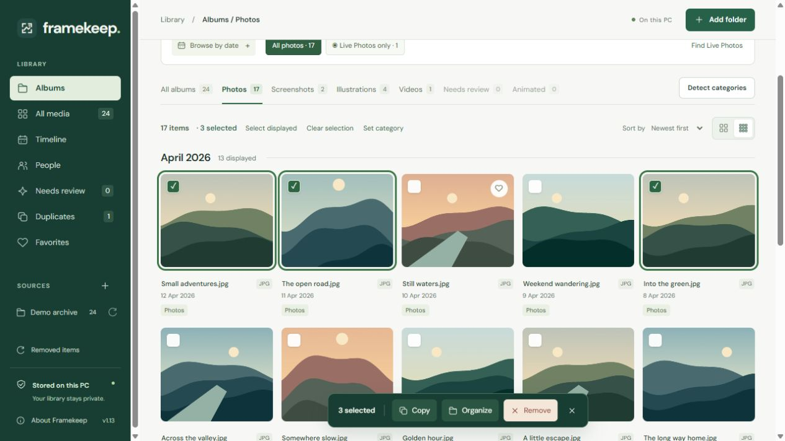

# Framekeep: organizing old phone backups

Framekeep began with a personal collection of phone backups that was difficult to browse. Camera photos, screenshots, saved illustrations and iPhone Live Photo clips shared the same folders. Sorting them into new directories helped with storage, but viewing the collection still meant opening folder after folder.

The result is a Windows desktop photo library. Framekeep indexes existing folders and presents albums by category and date. It leaves the originals in place, with a separate workflow for creating organized, verified copies.

## Browsing without reorganizing the disk

Albums come from the local index, so a category correction changes the gallery without moving a file. Photos can be filtered by month, format, camera or tags. Selection supports Ctrl/Shift clicks and keyboard shortcuts for copying files or removing them from the library. Removal is reversible and affects the catalog only.

iPhone backups needed special handling. A Live Photo contains a still image and a motion clip; showing both as unrelated items fills the video album with short clips. Framekeep pairs them using embedded Apple identifiers and displays each pair as one photo. Actual videos have frame thumbnails and an in-app player. Playback uses a local preview, while exports retain both original Live Photo resources.

## Implementation choices

The application uses Python, FastAPI and SQLite, with a vanilla JavaScript interface inside a pywebview/WebView2 window. The same interface can run in a browser during development. This keeps the desktop and browser views on one code path without a frontend build step.

SQLite stores the catalog and manual corrections; album queries group this data by category and date. Incremental scans use file size and modification time to find changed files, and the gallery fetches results in pages. One background job runs at a time to limit competing work on the source drive. Very large collections still need benchmarking.

SHA-256 identifies files with identical contents. Perceptual hashes suggest some resized or recompressed copies for side-by-side review. Only exact duplicates qualify for optional export deduplication; a visual match never removes a photo.

Optional category detection runs a pretrained CLIP model locally. Uncertain results remain in Needs review, and manual corrections survive rescans of unchanged files. People grouping uses pretrained OpenCV YuNet and SFace models, with controls to correct suggested groups.

## Protecting the originals

Exports preview the destination structure, avoid overwriting existing names and verify copied files against their source hashes. Each run records its results in a local manifest. Rotation and cropping also save a new image rather than overwriting the source.

The backend listens on the loopback interface and requires session credentials. Original-media parsing runs in disposable processes with time and memory limits. This contains resource use and decoder failures; the workers still run as the current Windows user. Thumbnails, metadata and face data remain local and are not encrypted at rest. The [technical reference](docs/TECHNICAL.md#local-access-and-desktop-restrictions) documents the boundaries and limits.

## Validation and remaining work

The [test suite](tests/) covers metadata precedence, incremental scans, corrupt media, session authentication, path boundaries, worker limits, Live Photo pairing and verified exports. GitHub Actions runs the checks on Windows. Optional tests that need model assets stay offline and are skipped in CI when those assets are absent.

Local smoke tests exercise category detection and face grouping, but do not establish general recognition accuracy. Categories can be ambiguous, face matches need review, and perceptual hashes can miss crops or burst photos. The gallery screenshot uses generated landscapes and contains no personal library data.

The current release launches from a Python environment. A standalone installer, large-library benchmarks, broader visual-match evaluation and automated browser accessibility checks remain future work. [Interface notes](DESIGN.md) describe the gallery layout and selection behavior; [setup instructions](README.md#run-on-windows) cover running the application.

Framekeep was developed with AI coding assistance. Its recognition models are pretrained; model sources and licenses are listed in [Third-party notices](THIRD_PARTY_NOTICES.md).
