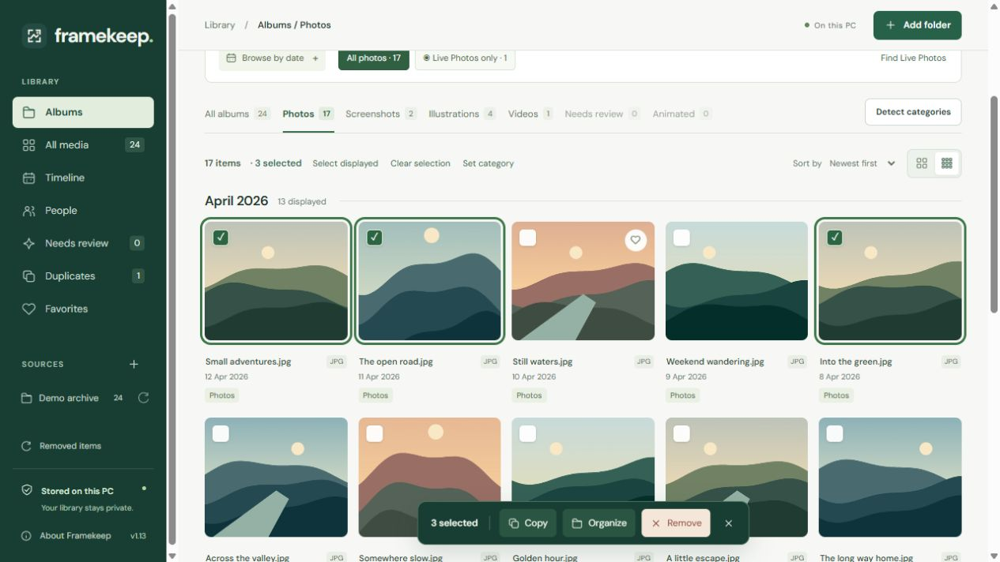

<p align="center"></p>
<h1 align="center">Framekeep</h1>
<p align="center">A local photo library for Windows. Browse phone backups without moving the originals.</p>

[](https://github.com/beekind78/framekeep/actions/workflows/ci.yml)



Phone backups often mix photos, screenshots, saved artwork and short video clips. Framekeep brings them into one gallery, grouped by category and date. Your files stay in their original folders.

[Install](#run-on-windows) | [Browse and sort](#typical-workflow) | [Shortcuts](#selection-and-editing) | [Changelog](docs/CHANGELOG.md) | [Project case study](PORTFOLIO.md)

For bugs or patches, see the [contributing guide](CONTRIBUTING.md). For vulnerabilities, see the [security policy](SECURITY.md).

## What you can do

- Browse photos and videos by album, month or source folder.
- View an iPhone Live Photo as one photo, with its motion available in the viewer.
- Play videos in the app and see real video frames in thumbnails.
- Review suggested categories, groups of people and possible duplicates.
- Copy files, edit a new image copy, or remove items from the library while keeping the originals.
- Create organized copies in a folder you choose.

Supported images: JPEG, MPO, PNG, HEIC/HEIF, WebP, GIF, TIFF, BMP and AVIF. Supported videos: MOV and MP4. Video thumbnails and playback use FFmpeg from Framekeep's Windows tools folder or from PATH.

## Run on Windows

You need **64-bit Python 3.11 or later** on PATH and **Microsoft Edge WebView2 Runtime**. WebView2 is already present on many Windows PCs.

1. Clone or download this repository.
2. Double-click **Setup Framekeep.cmd** to install the dependencies.
3. Open the **Framekeep desktop shortcut** or **Start Framekeep.cmd**.
4. Choose **Explore a sample library** to try the app, or **Add folder** to use your own backup.

Framekeep opens in its own window. Opening the shortcut again brings that window forward. If you move the project folder, run **Create Framekeep shortcuts.cmd** to recreate the shortcuts.

Closing the window stops the service it started. Scans, category analysis and Find people save progress so you can resume when you reopen Framekeep. Completed copies remain available. See the [technical reference](docs/TECHNICAL.md#desktop-lifecycle) for development-service behavior.

## Typical workflow

1. Choose **Add folder** and select a backup folder. The scan creates a local catalog and thumbnails.
2. Open **Albums**, or select a source folder in the sidebar.
3. Choose Photos, Screenshots, Illustrations, Downloads or Videos. Use the year and month filters to narrow the view.
4. Open an item to view it. Use the arrows or left/right keys to move through the results.

To collect downloaded images, open a photo and set its category to **Downloads**. You can also select several images and use **Set category**.

Albums are views of your existing files. You can browse them without creating output folders.

**Load more photos** adds results to the current gallery. When you close the viewer, you return to the same place. Framekeep loads thumbnails near the visible area and releases ones farther away as you scroll.

MPO files contain multiple still images and may have a `.JPG` name in a backup. Framekeep displays the first image. An organized copy keeps the full MPO file. If a scan reports an incomplete (truncated) image, try a complete copy from your backup.

For incomplete JPEGs, choose **Recover JPEG copies** in the completed scan report. Select **Review larger library matches** to compare the damaged photo and each suggestion side by side. Approve the larger copy or use the recovered JPEG. Framekeep saves approved matches as verified `-library-match` copies.

When the review is complete, choose **Create recovered copies**. Framekeep saves each run in its own subfolder under **Framekeep Recovered** in your user folder. Use **Browse** to choose a different location. Choose **View recovered photos** in the report to browse, tag, edit or remove the copies from the library.

For files without a usable match, Framekeep saves the readable parts as recovered JPEGs. **Trim a small gray edge** can crop a short band of obvious decoder padding. Review the copies for missing areas before adding them to your library.

Select **AI enlargement (3×)** to make a larger copy of a small recovered JPEG. The first use downloads a 240 KB model. Processing runs locally. Eligible copies have `-recovered-ai3x` in their names. The model estimates pixels from the available image, so missing details still need a complete backup.

### Sort photos into categories

1. Choose **Detect categories** above the gallery.
2. Review the Photos, Screenshots and Illustrations albums.
3. Check **Needs review** for images the model could not classify confidently.

The first run downloads the SigLIP 2 vision model, about 95 MB. Detection then runs on your PC. New scans use the model after it is installed.

Open **Needs review > Review in batches** to see which photos are awaiting analysis and which have uncertain suggestions. Pick a category, select the previews that fit, and approve them together. Identical files in the current view share one preview. Use **Batch history** to undo an approval while keeping later manual changes.

Choose **Accept all AI suggestions** to confirm every available suggestion across the current filters. The confirmation shows how many photos will move to each category. The whole approval can be undone from **Batch history**.

To correct a result, open the image and choose **Save category**. For several images, select them and choose **Set category**. Corrections are kept when unchanged files are rescanned. **Use automatic suggestion** clears a manual correction.

### View iPhone Live Photos

Live Photos appear in **Albums > Photos**. Their short motion clips are hidden from the Videos album once paired.

1. For a folder already in your library, choose **Photos > Find Live Photos** once. New scans check for pairs automatically.
2. Use **Live Photos only** to show just those items.
3. Open one and choose **Play Live Photo**. Choose **Show still photo** to return to the image.

Motion playback needs FFmpeg and starts muted. Enable sound in the player if you want audio. Each pair counts as one photo, while both original files remain on disk. Uncertain pairs stay separate.

### Play a video

Open a video and click the play icon on its thumbnail. The first play may take time while Framekeep prepares a local playback copy. The player provides seek, volume, playback speed and fullscreen controls.

Choose **Playback quality > High (up to 4K)** to keep more source resolution. The default 720p mode prepares faster. A smaller original plays at its available resolution. Longer 4K clips may hit the preparation time or 256 MiB playback limit.

If a video cannot play, use **Show original in folder** to open it with another player. See the [media limits](docs/TECHNICAL.md#media-previews) for supported sizes and durations.

### Review duplicates

1. Choose **Needs review > Analyze photos** to check uncertain categories and look for visual matches.
2. Open **Duplicates** and choose a tab:

   - **Exact duplicates** shows files with identical contents.
   - **Similar photos** suggests some resized or recompressed copies for side-by-side review.

Suggestions need your review. Similar photos can miss crops, bursts and colour edits. A possible match never deletes or merges a file. Export deduplication uses exact matches only.

### Group photos by people

Open **People > Set up people**. The first run downloads models of about 39 MB; grouping then runs on your PC.

Use **Find people** to choose a source, year or month, and how many pending photos to scan. **Pause** saves the run so you can reopen Framekeep and select **Resume**. The next run skips photos already analyzed.

Review the suggested groups before naming, merging or separating them. Matches can be wrong, and the app does not know anyone's name automatically.

## Selection and editing

| Action | Shortcut |
| --- | --- |
| Select or deselect one item | Ctrl+click |
| Select a range | Shift+click |
| Add a range to the selection | Ctrl+Shift+click |
| Select all currently displayed items | Ctrl+A |
| Copy selected originals to the Windows clipboard | Ctrl+C |
| Remove selected items from Framekeep, after confirmation | Delete |
| Open the context menu from the keyboard | Shift+F10 |

Load more results before Ctrl+A if you want to include them. Shortcuts do not interrupt typing fields or the viewer. One action can include up to 5,000 items.

Right-click a selected photo to act on the whole selection. Right-click an unselected photo to select that photo alone. The menu includes copying files or paths and copying to a folder. For one image, it also offers tags, categories, favorites and **Edit image copy**.

**Remove from Framekeep** changes the catalog only. The files stay in File Explorer. To bring them back, open **Removed items** in the sidebar.

To remove a source folder, right-click it in the sidebar and choose **Remove folder from Framekeep**. Its files, tags, categories and people matches are retained.

In **Removed items**, choose **Forget from Framekeep** and confirm to clear a folder or file's saved catalog details. You can still open the originals in File Explorer. Adding the folder again, or rescanning an active source that contains a forgotten file, creates fresh records.

**Edit image copy** lets you rotate or crop an image, then save a new JPEG in a separate folder. The original stays untouched. Editing a Live Photo or animation saves a still image.

## Create organized copies

1. Select the items you want, then choose **Organize copies**.
2. Choose an output folder and a layout, such as **Category > year > month**.
3. Choose **Preview folders**, check the result, then choose **Create verified copies**.

For example:

```text
Your output folder/
  Photos/2026/April/IMG_0001.heic
  Screenshot/2026/April/screen.png
  Illustration/2025/January/drawing.jpg
  Video/2026/April/clip.mov
```

Leave **Put this run in a new Framekeep folder** unchecked to use the output folder directly. Enable it to keep this run in its own folder. To copy a whole source, choose **All media** and clear any selection and filters first.

Existing files are never overwritten. Copies are checked against their originals, and each run creates a CSV manifest listing its results. Live Photo copies keep the still image and motion clip together. [Export details](docs/TECHNICAL.md#exports-and-edits) explain naming, duplicate handling and cancellation.

## Privacy and local data

- Photos, videos and model analysis stay on your PC. There are no analytics or required logins.
- Internet access is needed for setup and optional model downloads.
- The local catalog, thumbnails and face data are stored in `%USERPROFILE%\.framekeep\data`.
- Local library data is not encrypted at rest. Framekeep cannot protect it from malware already running as your Windows account or an administrator.

Keep backups and output folders outside the source checkout. If you want copies to stay only on this PC, choose folders that are not synchronized to a cloud service. Export manifests contain source paths and belong with your private collection.

See the [security and storage details](docs/TECHNICAL.md#local-data) and [publishing checks](docs/PUBLISHING.md).

## Project details

- [Project case study](PORTFOLIO.md): the original problem, implementation choices and remaining work.
- [Technical reference](docs/TECHNICAL.md): architecture, development setup, tests and processing limits.
- [Interface notes](DESIGN.md): gallery layout and selection behavior.

Framekeep was developed with AI coding assistance and uses pretrained recognition models. Application code and original demo illustrations use the [MIT license](LICENSE). Model sources and separate licenses are listed in [Third-party notices](THIRD_PARTY_NOTICES.md).
