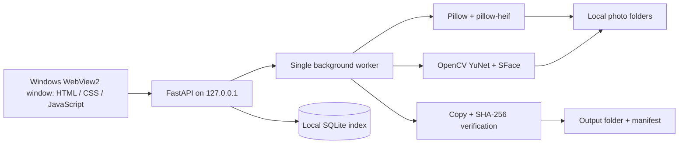

# Technical reference

[Back to the README](../README.md) for installation and everyday use.

This page covers the implementation, security boundaries and processing limits. Framekeep is intended for one user on one PC. It is not a service for public hosting.

## Architecture



The frontend uses browser APIs and local SVG icons, with no build step. Python modules separate indexing and queries, background jobs, face analysis and HTTP handlers.

SQLite uses WAL mode with one connection per operation. Scans compare file size and modification time, then hash new or changed files. Gallery queries return results in pages. Albums are computed from the catalog; browsing them does not reorganize files.

### Category detection and visual matches

Camera make/model metadata, explicit screenshot filenames and animation metadata take precedence over the optional CLIP model. Other images use visual classification, with uncertain predictions left in Needs review. A PNG extension or phone-sized dimensions alone do not make an image a screenshot.

Analyze photos works within the current source, search and date filters. It preserves manual categories and skips video decoding. Visual fingerprints are generated in the bounded image worker and tied to the indexed SHA-256. Changed files invalidate their cached fingerprints.

Similar photos returns direct matching pairs rather than groups connected through intermediate matches. Very plain images are excluded. The interface reports fingerprint coverage and asks for narrower filters if a search reaches its limit. A similarity suggestion is not an accuracy estimate.

People grouping compares normalized SFace vectors using cosine similarity. A threshold of 0.48 and up to eight reference vectors per group favor separate suggestions over premature merges. Corrections are stored locally. Changed files are analyzed again on the next People run.

### Live Photo pairing

Pairing uses embedded Apple identifiers in HEIC/JPEG stills and MOV motion resources. It does not guess from filenames or timestamps. Missing identifiers, conflicting identifiers and ambiguous multiple matches stay separate.

The catalog retains both resources but counts a linked pair as one item. Photos includes the pair; Videos excludes its motion clip by default, including album API reads. Manual category overrides remain in place.

## Development

Run these commands from the repository root:

```powershell
python -m venv .venv
.\.venv\Scripts\python.exe -m pip install -r requirements-dev.txt -c requirements-lock.txt
.\.venv\Scripts\python.exe run.py
```

`run.py` opens browser mode. Add `--no-browser` to leave the service running without opening a tab. Opening a bare local URL does not authorize a session; use the launcher.

For the desktop window, run `.\.venv\Scripts\python.exe desktop.py`. The normal shortcut uses `pythonw.exe`, so no terminal appears. The host uses pywebview and the Edge Chromium renderer, with no Internet Explorer fallback.

Python's Windows installer normally includes Tk for the folder picker. A typed folder path also works.

### Desktop lifecycle

- Reopening the shortcut activates the existing window.
- Closing the window stops a service that the desktop launch owns. Stop Framekeep.cmd can also close the window.
- If the desktop attached to an independently started development service, closing the window leaves that service running. Run Stop Framekeep.cmd again after the window closes to stop it.

A per-launch marker in the DPAPI-protected runtime record tracks ownership across Windows Python redirector process IDs. Named events activate or close the per-user window; they carry no photos or credentials.

## Local data

| Location | Contents |
| --- | --- |
| `%USERPROFILE%\.framekeep\data` | SQLite catalog, thumbnails, face previews/vectors, models, demo illustrations and media caches |
| `%USERPROFILE%\.framekeep\runtime` | Protected launcher and service credentials, temporary WebView profiles |
| `%USERPROFILE%\.framekeep\logs` | Launcher logs |

Set `FRAMEKEEP_DATA` before starting to change the data location. Runtime credentials use their own protected directory regardless of this setting.

The profile directory is shared by ordinary Windows launches and launches from packaged desktop apps, avoiding AppData virtualization. Versions before 1.1.1 used AppData; keep that directory until existing library data has been migrated.

Fonts and interface assets are local. There are no photo uploads, analytics scripts, required logins or cloud inference calls. Internet access is needed for package installation and optional model downloads. Model versions are pinned and downloads are checksum-verified. ONNX Runtime telemetry is disabled in the category worker.

Library metadata, thumbnails, face data and exports are not encrypted at rest. The app cannot protect them from malware running as the same Windows account or an administrator. Local, nonsynchronized source, data and output folders keep copies out of cloud sync services.

Export manifests contain source paths. Keep them with the private collection. See [Publishing source safely](PUBLISHING.md) for staged-file checks, asset review and repository exclusions.

## Local access and desktop restrictions

### Session authentication

Every sensitive API read and mutation requires a random session credential. A one-use launch ticket expires after 60 seconds and exchanges for a 12-hour session. The browser removes the ticket from the URL fragment before exchange.

The session token stays in origin-and-port-scoped sessionStorage. API and image requests send it in headers, rather than authentication cookies or credential-bearing image URLs. Relaunch after a server restart or expired session.

### Launcher authentication

The launcher has a separate per-process control credential. On Windows, the runtime directory and file DACL permits only the owner and SYSTEM. DPAPI encrypts the credential for the current user.

An HMAC challenge verifies the listener before the launcher sends control authority. Fresh server instances rotate credentials. Calling the local API alone does not authorize another Windows user. Runtime credentials must not be shared or published.

### WebView restrictions

WebView2 uses a private, temporary profile under the protected runtime directory. It does not reuse the user's normal browser profile or expose an application Python API to page JavaScript.

Navigation is restricted to the exact local app root. File URLs, downloads, external popups, browser permissions and developer tools are disabled. Origin/fetch-site checks, a restrictive content security policy, trusted-host checks and same-origin resource protection also apply.

## Original-file processing

Original-image parsing, face extraction and movie metadata reads run in disposable processes. The default worker limits are:

| Limit | Value |
| --- | --- |
| Wall time | 25 seconds |
| CPU time | 20 seconds |
| Memory | 1 GiB per process |
| Concurrent image workers | One |

Windows uses Job Objects; Linux uses resource limits. Processing fails closed if limits cannot be installed. Workers still run as the current account: this is resource isolation, not an OS privilege sandbox.

### Images

Allowed decoders are JPEG, PNG, WebP, GIF, TIFF, BMP, HEIF and AVIF.

| Input limit | Value |
| --- | --- |
| Encoded file size | 256 MiB |
| Image area | 50 megapixels |
| Longest side | 30,000 pixels |

EXIF orientation and date precedence are preserved. Preview JPEGs omit source EXIF. Oversized, unsupported, corrupt or timed-out files are reported as skipped. Rescanning an older index revalidates files against this policy.

### Movie metadata

The MOV/MP4 parser seeks past video payloads without decoding frames or following container references.

| Input limit | Value |
| --- | --- |
| Video file size | 64 GiB |
| Metadata reads | 1 MiB |
| Atom count | 4,096, with bounded nesting |

Movie creation timestamps are interpreted as UTC and converted to the PC's local time. Missing timestamps fall back to filename dates, then file-modified time. Image dates use EXIF, then filename, then file-modified time. EXIF dates are displayed as recorded, without timezone normalization.

Image formats are confirmed by the decoder. MOV/MP4 files need a video track. Detected content takes precedence over a misleading filename extension; scan reports count images, videos and skipped metadata separately.

### File boundaries

Descendant links, junctions and reparse points are rejected. Reads for decoding, hashing and export recheck the source boundary, including the physical path of the opened file.

Cloud placeholders need to be copied into an ordinary local backup folder before import. Disconnected drives remain indexed until a successful rescan; reconnect a drive to open or copy its originals.

## Media previews

FFmpeg prepares local playback copies and frame thumbnails. Originals are never transcoded in place. Input SHA-256 checks run before decoding; FFmpeg accepts local MOV input with network protocols and external track references disabled.

| Operation | Input limit | Output limit |
| --- | --- | --- |
| Live Photo motion | 128 MiB, 10-second source | 6 seconds, 960 pixels, 24 fps, 8 MiB |
| Video thumbnail | 2 GiB | JPEG, 480 pixels per side, 512 KiB |
| Ordinary video playback | 2 GiB, 30 minutes | 720p, 30 fps, 256 MiB |

| Operation | FFmpeg timeout | Worker wall time | CPU time per process |
| --- | --- | --- | --- |
| Live Photo motion or video thumbnail | 18 seconds | 25 seconds | 20 seconds |
| Ordinary video playback | Within the worker deadline | 180 seconds | 150 seconds |

Each preview process has a 1 GiB memory limit. On Windows, a kill-on-close Job Object allows the wrapper and one FFmpeg child. Both stop if the wrapper exits. Image workers retain their one-process limit. Native work shares the image-worker semaphore.

### Video thumbnails

The source size, timestamp and hash are checked before a read-only copy goes into a parent-owned temporary directory. The parent cleans it up after success, failure or timeout.

A frame is selected from 12 downscaled samples near the start. Orientation is applied and source metadata is stripped. The sampled frame may not be the most recognizable moment.

Authenticated image requests load at most two posters at once and defer off-screen posters. The JPEG cache targets 64 MiB. Cache hits check source availability, size and timestamp; reindexing changed content selects a new hash-based entry. Browsing does not change originals or catalog records.

### Playback

Live Photo playback is prepared after an authenticated Play request. H.264/AAC MP4 previews stay in local app data and start muted.

Ordinary video conversion runs one job at a time. Closing the viewer or app cancels unfinished preparation and removes temporary files. Failed, oversized or incomplete output is rejected rather than presented as a truncated movie.

Playback files are fetched through the authenticated API and played from temporary blob URLs. No session credential appears in a media URL. The playback cache targets 512 MiB, excluding a current conversion and files still held open by a response.

HDR previews may look different. Original HDR resources remain unchanged. Subtitles, multiple audio tracks and professional video editing are not supported.

## Exports and edits

### Verified copies

Exports preview their layout, verify copied hashes and record results in a CSV manifest. Existing names get a numbered suffix instead of being overwritten.

Direct output reuses existing folders and creates a uniquely named manifest. An optional separate run directory uses `manifest.csv`. Category output uses Photos, Screenshot, Illustration and Video; Needs review and Animated get folders when present. Only years and months containing copies are created.

A source changed after indexing is skipped with an error. Cancellation keeps completed copies and their manifest entries. Destination links and junctions are rejected; Windows directory handles prevent destination-folder swapping during copying.

Exports use the detected extension without renaming the source. JPEG content named `photo.MOV` becomes `photo.jpg` in the output. A QuickTime movie named `clip.HEIC` becomes `clip.mov`.

Exporting either Live Photo resource includes both originals in the still image's target folder with a shared filename stem. Original Apple metadata is retained. Deduplication skips only an identical complete pair, preserving different motion even when still images match. Apple editing, effects and iCloud synchronization are outside the app's scope.

### Clipboard and catalog removal

Context actions require the same session and origin checks as other private APIs. Clipboard writes use registered, checked paths, Unicode CF_HDROP and the copy drop effect from the [Windows clipboard formats](https://learn.microsoft.com/en-us/windows/win32/shell/clipboard). There is no clipboard read permission or general native bridge.

Batch actions include each Live Photo resource once. Stale or unavailable selections are rejected before catalog removal can partially affect other items. Holding a shortcut key does not repeat an action.

Removing items invalidates pending export plans. Removed originals and their faces are unavailable through media APIs until restored. Restoration rescans the source and keeps tags, categories, favorites and people matches. Ordinary rescans preserve individual removals. Live Photo resources are removed and restored together.

### Image edits

Edits verify the source hash, apply EXIF orientation, then rotate or crop at source resolution. The display preview is downscaled. Saving creates a new JPEG, with exclusive creation, a numbered suffix on name conflicts and hash verification.

The standard image input and worker limits apply. Saved JPEGs are limited to 10 MiB. They retain a capture timestamp and normalized orientation, while omitting GPS and other source EXIF. Animations produce a still frame. Video editing, RAW processing and color-managed HDR editing are not included.

## Tests

Run from the repository root:

```powershell
.\.venv\Scripts\python.exe -m pytest -q
.\.venv\Scripts\python.exe -m ruff check .
node --check framekeep/static/app.js
node --check framekeep/static/context.js
python scripts/check_publication.py
```

GitHub Actions runs the checks on Windows. Tests create temporary media; personal photos are not required.

| Area | Coverage |
| --- | --- |
| Indexing | Date precedence, corrupt files, HEIC/AVIF, orientation, exact copies, incremental policy revalidation, tags and favorites |
| Categories | Old-index migration, uncertain predictions, failed model integrity checks, edits, override persistence/reset, filters, counts and exports |
| Albums | Authenticated reads, source/category/date/search/favorite filters, regrouping, covers, pagination and unchanged originals |
| Similar photos | Resized/recompressed, plain and unrelated images; direct pairs; search limits; stale fingerprints; cancellation and video exclusion |
| Live Photos | Apple identifiers, MOV layouts, renamed resources, ambiguous matches, missing/replaced sources, collapsed counts, motion access and paired exports |
| Security and exports | Sensitive API reads, ticket expiry/reuse, rotated sessions, spoofed listeners, origins, worker limits, source changes and path/junction replacement |
| Desktop | Navigation restrictions, one-window activation, service ownership, borrowed services, close/restart and retained library data |

### Optional integration checks

Offline model tests use `FRAMEKEEP_CATEGORY_TEST_ASSETS`. Point it at a directory containing `runtime/clip-vit-base-patch32-int8.onnx` and permitted images under `validation/`. CI skips these tests instead of downloading weights.

The local category smoke test distinguishes a camera image, an app screenshot and an original sample illustration. The face smoke test uses an OpenCV sample and a rotated variant: two detections and one suggested group. Neither check establishes general recognition accuracy; no sample face is committed.

An optional offline FFmpeg test generates a clip and converts it in the bounded worker. Native UI checks use generated artwork and motion clips. The [publication guide](PUBLISHING.md) explains the source allowlist and reviewed assets.

## Current limits

- Categories and people matches need review. Screenshots containing photos or art, scanned documents, game captures and stylized photography can be ambiguous. Faces may be missed or confused; the app does not infer names or personal attributes.
- Exact hashing finds identical contents only. Visual matching can miss crops, bursts and colour edits.
- File-modified dates can reflect a backup date. EXIF dates are not timezone-normalized.
- A file changed without changing its size or modification time may need reindexing. Exports independently verify the source hash.
- Very large libraries have not been benchmarked. Hashing, thumbnails and CPU inference need time and disk space; process startup adds overhead.
- Worker limits reject very large photos. Face extraction handles up to 50 detections per image.
- Camera RAW and video containers other than MOV/MP4 are not indexed. Playback supports only the sizes and durations above.
- The supported desktop workflow uses the Windows launchers and folder picker. This release has no signed installer or standalone executable.
